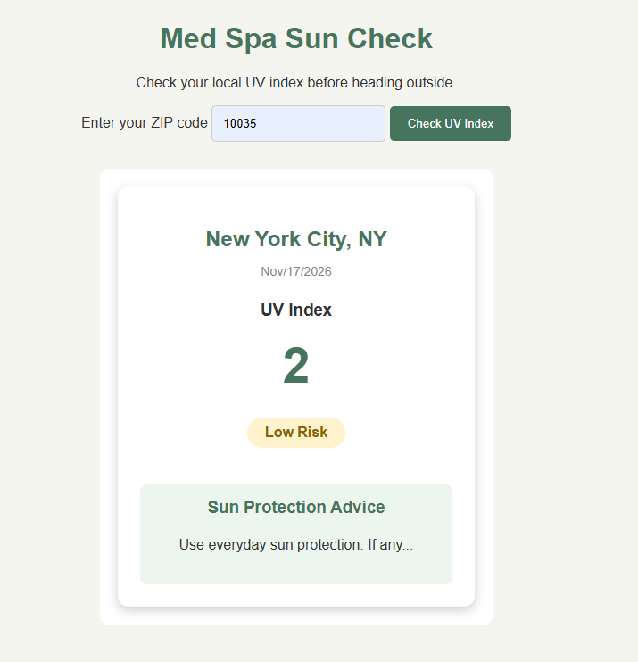

# Med Spa Sun Check

A web application that helps users check the UV index in their area and receive sun protection recommendations based on current UV risk levels.

Built with HTML, CSS, and JavaScript, the application integrates two external APIs to transform a user's ZIP code into location-specific UV information displayed through a clean, user-friendly interface.

## Live Demo

**[View Med Spa Sun Check](https://anwaralshohatee.github.io/med-spa/)**

## Technologies


## Features

- Search for UV index information using a five-digit U.S. ZIP code
- Retrieve city and state information automatically
- Fetch UV index data from the EPA
- Display the UV index and forecast date
- Classify UV exposure into five risk levels
- Provide sun protection recommendations based on UV risk
- Validate ZIP code input
- Display loading and error messages
- Present results in a clean, responsive card layout

## Screenshot



## How It Works

1. Enter a valid five-digit U.S. ZIP code.
2. Click **Check UV Index**.
3. The application requests location information from the Zippopotam.us API.
4. It uses the ZIP code to request UV index data from the EPA API.
5. The application displays the city, state, UV index, risk level, and sun protection advice.

## APIs Used

### Zippopotam.us API

Retrieves location information associated with a U.S. ZIP code, including the city and state.

https://api.zippopotam.us/

### EPA UV Index API

Provides UV index forecast data based on ZIP code.

https://www.epa.gov/sunsafety/uv-index-1

## Getting Started

### 1. Clone the Repository

```bash
git clone https://github.com/AnwarAlshohatee/med-spa.git
cd med-spa
```

### 2. Run the Application

Open `index.html` in your browser.

No additional dependencies or installations are required.

An internet connection is required to retrieve location and UV index data.

## UV Risk Levels

| UV Index | Risk Level |
|----------|------------|
| 0–2 | Low |
| 3–5 | Moderate |
| 6–7 | High |
| 8–10 | Very High |
| 11+ | Extreme |

The application displays sun protection guidance based on the UV risk category.

## Future Improvements

- Add geolocation to detect the user's location automatically
- Display hourly UV forecasts
- Add weather information alongside UV index data
- Improve the wording and detail of sun protection recommendations
- Enhance error handling for unavailable API responses

## Author

**Anwar Alshohatee**

[Portfolio](https://anwaralshohatee.netlify.app) | [LinkedIn](https://www.linkedin.com/in/anwaralshohatee/)
